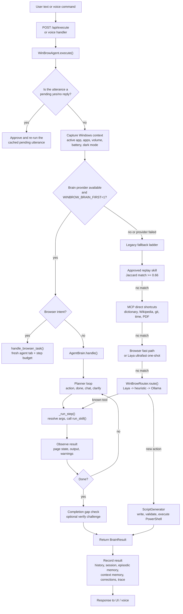
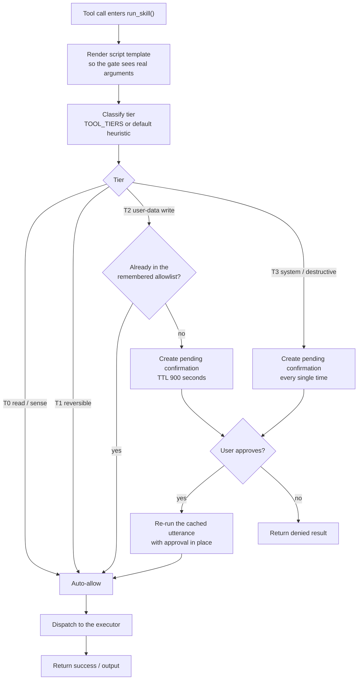

# WinBrow 🤖

**A Windows-first desktop and browser control agent that turns a sentence into real actions.**

WinBrow listens to or receives a command, plans it with a cloud or local language model, and executes it through native Windows APIs, PowerShell, raw Chrome DevTools Protocol, native HTTP web tools, MCP servers, or app-specific adapters. It remembers what happened, learns reusable tools and skills, and gates every action through a tiered permission system.

> Platform: **Windows 10 / 11** · Runtime: **Python 3.10+** · UI: **http://127.0.0.1:8765** · Server version: **3.0.0**

---

## Table of contents

1. [What WinBrow does](#1-what-winbrow-does)
2. [Architecture flowchart](#2-architecture-flowchart)
3. [Request lifecycle flowchart](#3-request-lifecycle-flowchart)
4. [Permission gate flowchart](#4-permission-gate-flowchart)
5. [Component catalog](#5-component-catalog)
   - [Entry points and runtime](#51-entry-points-and-runtime)
   - [Orchestration and routing](#52-orchestration-and-routing)
   - [Brain and model layer](#53-brain-and-model-layer)
   - [Tool registry and executors](#54-tool-registry-and-executors)
   - [Browser automation stack](#55-browser-automation-stack)
   - [Desktop and computer stack](#56-desktop-and-computer-stack)
   - [Memory and learning](#57-memory-and-learning)
   - [Skills system](#58-skills-system)
   - [Voice pipeline](#59-voice-pipeline)
   - [Safety and permissions](#510-safety-and-permissions)
   - [Documents, layout, and generation](#511-documents-layout-and-generation)
   - [MCP servers and integrations](#512-mcp-servers-and-integrations)
   - [Data and state files](#513-data-and-state-files)
6. [Technology stack](#6-technology-stack)
7. [Project layout](#7-project-layout)
8. [Getting started](#8-getting-started)
9. [Configuration](#9-configuration)
10. [API reference](#10-api-reference)
11. [Example commands](#11-example-commands)
12. [Testing](#12-testing)
13. [Troubleshooting](#13-troubleshooting)
14. [Design invariants](#14-design-invariants)
15. [Credits and provenance](#15-credits-and-provenance)

---

## 1. What WinBrow does

WinBrow is not a screenshot-and-click loop. It is a layered agent with cheap deterministic paths in front of an expensive planner:

| Layer | What happens | Typical latency |
|---|---|---|
| **Deterministic tools** | A matching registry tool runs directly through PowerShell, Win32, or an adapter | Fast |
| **Procedural replay** | A previously-approved multi-step plan is replayed when the utterance matches | Fast |
| **Brain planner** | A cloud LLM plans and executes step by step: plan → act → observe → verify | Seconds |
| **Generator fallback** | When no planner is available, an LLM writes a PowerShell tool, validates it, runs it, and can persist it | Slow, one time |

**Core design choices**

- **Brain-first by default.** `WinBrowAgent.execute()` sends every request to the planner before replay, MCP shortcuts, the browser fast path, or the router. Fallbacks exist for an unavailable or failed provider. Set `WINBROW_BRAIN_FIRST=0` only for legacy debugging.
- **One dispatch funnel.** Every tool call goes through `WinBrowAgent.run_skill()`, which is the single permission gate and the single execution point.
- **Raw CDP, not a browser framework.** Browser control is implemented directly against Chrome DevTools Protocol. There is no Playwright, Selenium, or pydoll dependency.
- **Progressive disclosure for skills.** The planner sees only skill metadata until it chooses a skill; the full `SKILL.md` body is injected on the next turn.
- **Tiered safety.** Read-only actions are automatic, writes require confirmation, and system/destructive actions always require confirmation.
- **Local-first data.** Memory, traces, permissions, secrets, learned tools, and model files stay on the machine.

---

## 2. Architecture flowchart

```mermaid
flowchart TB
    subgraph Input["Input surfaces"]
        UI["Web UI<br/>templates/index.html"]
        API["FastAPI REST + WebSocket<br/>server.py"]
        VOICE["Voice loop<br/>VAD + Whisper + SAPI"]
        CLI["Developer CLI<br/>python -m winbrow"]
    end

    subgraph Core["Agent core"]
        AGENT["WinBrowAgent<br/>execute() and run_skill()"]
        PERM["PermissionManager<br/>T0-T3 gate"]
        BRAIN["AgentBrain<br/>plan, act, observe, verify"]
        ROUTER["WinBrowRouter<br/>Laya, heuristics, Ollama"]
        REPLAY["Procedural replay<br/>tools/skills.json"]
        GEN["ScriptGenerator<br/>PowerShell fallback"]
    end

    subgraph Model["Model layer"]
        GW["ModelGateway<br/>Nebius, OpenRouter, OpenAI, local"]
        SW["Skill writer"]
        NORM["Normalize / autocorrect"]
    end

    subgraph Exec["Executors"]
        PS["PowerShell host<br/>windows.py, pshost.py"]
        COMP["Computer atoms<br/>and app adapters"]
        BR["Browser controller<br/>raw CDP"]
        WEB["Native web tools<br/>search and fetch"]
        DOC["Document tools<br/>and layout engines"]
        MCP["MCP bridge"]
        SH["Shell runner"]
        INST["Installer<br/>winget-first"]
        SS["Bundled skill scripts"]
    end

    subgraph Mem["State and memory"]
        SM["Session memory"]
        EM["Episodic store<br/>SQLite + FTS5"]
        VEC["Chroma<br/>vector index"]
        CM["Context memory"]
        LT["Learned tools"]
        SK["Skill registry<br/>SKILL.md"]
    end

    UI --> API
    API --> AGENT
    VOICE --> AGENT
    CLI --> AGENT

    AGENT --> PERM
    AGENT --> BRAIN
    AGENT --> ROUTER
    AGENT --> REPLAY
    AGENT --> GEN

    BRAIN --> GW
    BRAIN --> NORM
    BRAIN --> SW
    ROUTER --> GW
    GEN --> GW

    BRAIN --> PERM
    ROUTER --> PERM
    REPLAY --> PERM
    GEN --> PERM

    PERM --> PS
    PERM --> COMP
    PERM --> BR
    PERM --> WEB
    PERM --> DOC
    PERM --> MCP
    PERM --> SH
    PERM --> INST
    PERM --> SS

    PS --> OS["Windows OS, registry,<br/>files, processes"]
    COMP --> APPS["Windows applications"]
    BR --> BROWSER["Chrome, Edge, Brave"]
    WEB --> NET["Internet"]
    DOC --> FILES["Local documents"]
    MCP --> EXT["MCP servers<br/>and remote services"]
    SH --> OS
    INST --> OS

    AGENT --> SM
    AGENT --> EM
    EM --> VEC
    AGENT --> CM
    AGENT --> LT
    AGENT --> SK
    BRAIN --> SK
    SW --> SK
```



### 2.1 Plain-text pipeline

```
User / Web UI / Voice / CLI
              │
              ▼
     WinBrowAgent.execute()
              │
     ┌────────┴─────────┐
     ▼                  ▼
Brain-first       Fallback ladder
planner           replay → MCP → browser → router → generator
     │                  │
     └────────┬─────────┘
              ▼
     Permission gate T0–T3
              │
              ▼
     Executors: PowerShell, Win32/UIA,
     app adapters, CDP browser, web tools,
     documents, MCP, shell, installer
              │
              ▼
     Session + episodic + context + learned + skills
```

### 2.2 Component dependency sketch

```
server.py
  └─ WinBrowAgent (agent.py)
       ├─ ToolRegistry (registry.py) ── policy.py / windows.py
       ├─ WinBrowRouter (router.py) ── Laya worker, small_llm.py, resolvers.py
       ├─ AgentBrain (brain/agent_loop.py) ── model_gateway.py, prompt.py, skill_registry.py
       ├─ BrowserController (browser_task.py) ── HTTP /json or CDP WebSocket
       ├─ PermissionManager (permissions.py) ── policy.py
       ├─ SessionMemory + MemoryStore (memory/)
       ├─ SkillMemory (memory/skills.py) ── tools/skills.json
       ├─ ScriptGenerator (generator.py)
       ├─ MCP hub (mcp.py)
       ├─ Native web tools (web_tools.py) ── web_search, web_fetch
       └─ SubagentManager (subagents.py) ── scoped child AgentBrain instances
```

> `server.py` constructs `WinBrowAgent()` at import time. Any import failure in the agent dependency tree prevents the server from starting.

---

## 3. Request lifecycle flowchart



### 3.1 Response contract

`WinBrowAgent.execute()` returns a structured result:

```json
{
  "utterance": "open downloads folder",
  "route": {
    "kind": "tool",
    "tool_name": "open_folder",
    "args": {"folder": "downloads"},
    "confidence": 0.95,
    "latency_ms": 210.4,
    "probabilities": {},
    "tier": "laya"
  },
  "context": {
    "active_app": "Code.exe",
    "active_title": "desktop_agent",
    "running_apps": ["..."],
    "volume_level": 42,
    "is_muted": false,
    "dark_mode": true,
    "battery_percent": 88,
    "battery_plugged": true
  },
  "execution": {
    "type": "tool",
    "success": true,
    "output": "Opened C:\\Users\\...\\Downloads"
  },
  "total_elapsed_ms": 2350.7
}
```

Failures return `success: false` with an `output` message instead of raising across the API boundary.

---

## 4. Permission gate flowchart

Every registry tool call passes through `PermissionManager.gate()` from `run_skill()`.



| Tier | Meaning | Behavior |
|---|---|---|
| **T0** | Read / sense | Auto-allow |
| **T1** | Reversible action | Auto-allow |
| **T2** | User-data write / risky | Confirm once, remember the exact action key |
| **T3** | System / install / destructive | Confirm every time, never remembered |

Additional rules:

- Curated `permissions.TOOL_TIERS` overrides name-based heuristics.
- `policy.script_tier()` can lift a rendered script based on its content.
- Learned tools are floored at T2.
- Shell commands start at T2 and can be lifted to T3.
- `WINBROW_BYPASS_CONFIRM=1` bypasses every tier, including T3. Never use it in safety tests.
- `WINBROW_AUTO_APPROVE_T2=1` automatically remembers T2 actions.
- Confirmations can come from the voice callback, `POST /api/confirm`, or the UI.

---

## 5. Component catalog

### 5.1 Entry points and runtime

| File / component | Description |
|---|---|
| `server.py` | FastAPI application. Creates the global `WinBrowAgent`, loads `.env`, serves the UI, exposes REST and WebSocket endpoints, runs startup warm-up and shutdown cleanup. |
| `run.py` | Convenience launcher. Starts Uvicorn and opens `http://127.0.0.1:8765` in the default browser. |
| `start.bat` | Windows launcher. Frees port `8765` from a previous detached server, then starts Uvicorn with reload on `.` and `winbrow`. |
| `winbrow/__main__.py` | Enables `python -m winbrow <command>`. |
| `winbrow/cli.py` | Developer CLI, including `python -m winbrow observe` for a UIA tree/context dump. |
| `templates/index.html` | Single-page UI: hero, quick actions, live execution trace, proactive suggestions, command bar with microphone, and modals for Tools, Integrations, Subagents, and Settings. |
| `static/` | Reserved static asset directory. Currently empty. |
| `requirements.txt` | Core Python dependencies. |
| `.env.example` | Documented configuration template. Copy to `.env`. |
| `download_models.ps1` | PowerShell helper that downloads the Qwen GGUF, Whisper model, and llama.cpp server. |
| `catalogue.txt` | Generated plain-text catalog of computer atoms, adapter operations, and other tools. |
| `eval_cases.jsonl` | Small behavior evaluation cases mapping requests to expected tools. |
| `e2e_coldboot.py` | End-to-end cold-boot smoke test. Starts the server on port `8899` and probes API endpoints. |
| `diag_wiki_flake.py` | Diagnostic for the Wikipedia MCP server connection. |
| `clean_encoding.py` | Utility that repairs corrupted characters in text files. |
| `planner_prompt_original.txt`, `planner_prompt_compressed.txt` | Reference snapshots of the planner prompt. |

**Startup sequence**

1. Load `.env`.
2. Download or verify Whisper and other missing models in an executor.
3. Start llama.cpp / Qwen only when the local provider is enabled.
4. Log the brain provider status.
5. Warm the persistent PowerShell host.
6. Start the proactive `Observer` loop.
7. Connect preload-only MCP servers in the background.
8. On shutdown, close MCP, observer, LLM, and the PowerShell host.

---

### 5.2 Orchestration and routing

| Module | Description |
|---|---|
| `winbrow/agent.py` | **Master orchestrator.** `WinBrowAgent.execute()` implements permission interception, context capture, brain-first routing, replay, MCP shortcuts, browser paths, router dispatch, generator fallback, and recording. `run_skill()` is the single tool dispatcher and permission checkpoint. |
| `winbrow/router.py` | **Laya typed-choice router.** Tries Laya first, then a deterministic heuristic branch ladder, then an optional Ollama small-LLM tier. Returns a `Route` with kind, tool, args, confidence, latency, probabilities, reason, and tier. Includes a circuit breaker after repeated Laya timeouts. |
| `winbrow/small_llm.py` | Optional local Ollama routing tier for paraphrases and typos. Enabled with `WINBROW_ROUTER_LLM=1`. |
| `winbrow/ultrafast.py` | `LayaUltrafastEngine`: a per-step DOM + Laya typed-decision browser loop used as a one-shot fallback when the brain is unavailable. Harvests interactive elements, stamps `data-wb-idx`, decides, and executes click/type/scroll/wait/extract. |
| `winbrow/generator.py` | **Dynamic tool generator.** Builds a prompt from the utterance and active window, asks a model for a PowerShell tool, validates it with `policy.py`, executes it, and persists successful tools to `tools/learned.json`. Includes an offline synthesizer for common system tasks. |
| `winbrow/resolvers.py` | Argument resolvers. Compute and validate values instead of parse-to-decide: option IDs, volume clamping, folder/file resolution, extension matching. |
| `winbrow/files.py` | Machine-built file, folder, and application listings used for deterministic resolution. |
| `winbrow/apps.py` | Installed-application index and fuzzy launch resolution. |
| `winbrow/last_opened.py` | `ContextMemory`: remembers the last opened file, folder, and app so references like “that file” resolve. Persists to `tools/context_memory.json`. |
| `winbrow/trace.py` | Structured JSONL tracing for stages, commands, timings, and outcomes. Tracing never breaks execution. |
| `winbrow/observe.py` | Background Observer service that produces proactive suggestions from recent activity and exposes them to the UI. |

**Router branch order**

`STOP` → multi-step → Wikipedia → URL fetch → editor type/save → create file → URL download → winget → volume → lock → app launch → open folder/file → close folder → play/watch → browser interaction → web search → launch prefix → window action → settings → screenshot → clipboard → time → network → battery → dark mode → media keys → find files → bare URL → `NEW_ACTION`.

---

### 5.3 Brain and model layer

| Module | Description |
|---|---|
| `winbrow/brain/agent_loop.py` | **AgentBrain**: closed-loop planner. Builds messages, calls the model gateway with a JSON schema, parses `action`, `done`, `chat`, or `clarify`, executes one step at a time, injects skill detail, tracks history, detects stuck loops, checks completion gaps, and stops at the action budget. |
| `winbrow/brain/model_gateway.py` | **Provider-agnostic LLM gateway.** Provider chain: Nebius Token Factory → OpenRouter → OpenAI → local. Handles OpenAI-compatible chat calls, retries, reasoning-token policy, empty-content recovery, JSON extraction and repair, and `GatewayUnavailable`. |
| `winbrow/brain/prompt.py` | Static system prompt, planner JSON schema, model-specific prompt variants, skill metadata injection, and `SKILL DETAIL` injection. |
| `winbrow/brain/prompts.py` | Compatibility shim for the legacy prompt module name. |
| `winbrow/brain/skill_registry.py` | Progressive-disclosure skill registry. Parses `SKILL.md` frontmatter, validates skill keys, builds compact metadata under a character budget, loads full bodies, and hot-reloads new skills. |
| `winbrow/brain/skill_writer.py` | Turns a successful multi-step run into a reusable `SKILL.md`. Requires at least 3 successful steps, applies specificity guards, refuses to overwrite existing folders, and registers the new skill without a restart. |
| `winbrow/brain/normalize.py` | Autocorrect and normalization stage. Learns successful rewrites and persists corrections. |
| `winbrow/llm.py` | Local conversational LLM integration (Qwen via llama.cpp). |
| `winbrow/vision.py` | Vision fallback using Qwen2.5-VL for screenshot analysis and UI grounding. |
| `winbrow/model_manager.py` | Automatic model download and management: Whisper, Qwen GGUF, vision model, and llama.cpp/whisper.cpp binaries. |

**Model defaults**

| Provider | Default model | Notes |
|---|---|---|
| Nebius Token Factory | `deepseek-ai/DeepSeek-V4-Flash-0731` | First provider in `auto` when `NEBIUS_API_KEY` is set |
| OpenRouter | `deepseek/deepseek-v4.1-flash` | Fallback |
| OpenAI | Configured model | Fallback |
| Local | Qwen GGUF via llama.cpp | Opt-in with `WINBROW_LOCAL_LLM=1` or `WINBROW_BRAIN_PROVIDER=local` (`qwen` is an alias) |

Planner budget defaults: `max_tokens=16000`, `temperature=1`, reasoning cap `2000`. Browser-heavy turns use `8000` total / `600` reasoning. Action budget defaults to `20` steps with a `120 s` per-step timeout and a warning when `5` steps remain.

The **generator fallback** has its own provider order in `auto`: Gemini → OpenAI → an explicit OpenAI-compatible endpoint (Ollama or LM Studio) → the offline synthesizer. The Settings modal accepts Nebius, OpenRouter, OpenAI, Gemini, Ollama, and LM Studio.

---

### 5.4 Tool registry and executors

| Component | Description |
|---|---|
| `winbrow/registry.py` | Defines `ArgSpec` and `Tool`, loads `tools/seed.json` and `tools/learned.json`, and exposes `ToolRegistry.all_tools()`. |
| `tools/seed.json` | **43 built-in script tools** executed as PowerShell templates. |
| `tools/learned.json` | Dynamically generated tools persisted after a successful generator run. Currently 3 records. |
| `winbrow/permissions.py` | Tiered T0–T3 permission gate, pending confirmations, remembered allowlist, action hashing, and tier classification. |
| `winbrow/policy.py` | Hard-block regexes, dangerous-operation detection, script safety validation, and content-based script tiering. |
| `winbrow/windows.py` | Windows OS execution layer: PowerShell runner, context capture, volume, theme, windows, processes, files, and system primitives. |
| `winbrow/pshost.py` | Persistent PowerShell host that avoids a cold process spawn per command and survives script errors. |
| `winbrow/shell.py` | Shell command execution exposed as the T2 `run_command` tool, with timeout and output limits. |
| `winbrow/installer.py` | winget-first package management with streaming progress and install status. |
| `winbrow/document_tools.py` | `read_document` for PDF, PPTX, DOCX, XLSX/XLS, CSV, Markdown, HTML, JSON, and EPUB using markitdown with fallbacks. |
| `winbrow/mcp.py` | MCP client bridge. Starts stdio servers or connects to streamable HTTP, caches catalogs, registers tools as `mcp_{server}_{tool}`, and handles lazy reconnect and retry. |
| `winbrow/web_tools.py` | Native `web_search` and `web_fetch`. No browser is opened. Uses a browser-impersonated HTTP transport and main-content extraction. |
| `winbrow/subagents.py` | `delegate_task` and scoped child planners with filtered registries, profiles, run history, and sequential/parallel safety rules. |
| `winbrow/integrations.py` | Integration registry, DPAPI-backed local secret storage, masked reads, environment overrides, and connection tests. |
| `winbrow/skill_scripts.py` | Allowlisted runner for bundled Python helpers under `winbrow/skills/library/**/scripts/`. Passes a JSON spec, rejects traversal and symlinks, and enforces timeouts and output caps. |
| `winbrow/skill_script_utils.py` | Shared helpers for bundled converted-skill scripts. |

**Dispatch implementations**

| `impl` value | Executor |
|---|---|
| `computer` | Native computer atoms or async override |
| `adapter` | App-specific compound operations |
| `shell` | Shell command runner |
| `document` | Document reader |
| `web` | `web_search` / `web_fetch` |
| `browser` | Browser primitives, hard-capped at 20 s |
| `installer` | winget install/uninstall/upgrade |
| `mcp` | MCP tool call |
| `skill_script` | Allowlisted bundled helper |
| `integration` | Integration status |
| `subagent` | Scoped child planner |
| *(none)* | Rendered PowerShell template |

**Built-in tool catalog (43 seed tools)**

| Category | Tools |
|---|---|
| **System** | `system_volume`, `volume_set_level`, `toggle_dark_mode`, `lock_screen`, `system_uptime`, `system_spec_info`, `system_performance`, `current_time`, `screen_brightness`, `clipboard_inspect` |
| **Apps and windows** | `app_focus_or_launch`, `open_common_app`, `open_file`, `open_folder`, `close_folder_window`, `window_action`, `always_on_top`, `show_running_apps` |
| **Media and input** | `media_playback`, `screenshot_clipboard`, `take_screenshot`, `type_text` |
| **Settings** | `windows_settings`, `open_settings_page`, `bluetooth_settings`, `night_light` |
| **Files** | `find_files`, `find_large_files`, `organize_desktop`, `clean_temp_files`, `clean_downloads`, `quick_note`, `create_text_file`, `download_file`, `set_wallpaper` |
| **Network** | `network_status`, `get_wifi_password`, `public_ip` |
| **Power and processes** | `shutdown_timer`, `countdown_timer`, `kill_unresponsive_process` |
| **Battery** | `battery_health` |
| **Browser fallback** | `laya_ultrafast_browser` |

Additional runtime tools come from:

- 7 browser primitives,
- 10 computer atoms,
- 16 app-adapter operations,
- 2 native web tools,
- document, shell, installer, skill-script, integration, and subagent tools,
- dynamically registered MCP tools,
- generated learned tools.

The live count is available from `GET /api/system` (`tool_count`) and the full list from `GET /api/tools`.

---

### 5.5 Browser automation stack

| Module | Description |
|---|---|
| `winbrow/browser_task.py` | **Transport and controller.** Detects Chromium browsers, discovers CDP on port `9222` or through `DevToolsActivePort`, manages tabs, runs JavaScript, clicks, types, scrolls, captures screenshots, uploads files, and provides a PowerShell fallback. |
| `winbrow/browser_tools.py` | **Seven brain-facing browser tools:** `browser_navigate`, `browser_read_page`, `browser_read_full`, `browser_get_accessibility_tree`, `browser_upload_file`, `browser_interact`, `browser_wait`. Includes deterministic element matching, page-state rendering, and result annotation. |
| `winbrow/ultrafast.py` | Laya-driven per-step browser engine used when deterministic matching fails and as the no-brain one-shot fallback. |
| `winbrow/accessibility.py` | Standalone UIAutomation foreground tree. Currently unreferenced by the live agent; desktop grounding lives in `computer/uia.py`. |

**CDP backends**

1. **HTTP backend** — `GET /json/version`, `GET /json/list`, `PUT /json/new`, `GET /json/activate`, then a fresh page WebSocket per operation.
2. **Consent-mode WebSocket** — one persistent browser-level socket discovered from `<User Data>/DevToolsActivePort`, with `Target.attachToTarget {flatten: true}` and `sessionId` multiplexing.

**Browser behavior**

- The agent tab is isolated. If a remembered agent tab is gone, `_pick_tab()` returns `None` rather than hijacking a user tab.
- `reset_session()` clears references and the page cache but intentionally leaves the tab open for inspection.
- Page state is cached by URL, with no TTL. Blank snapshots are never cached and are retried for up to 3 seconds.
- Reads are T0; navigate, interact, wait, and upload are T1.
- Browser operations are capped at 20 seconds; the enclosing brain step is capped at 120 seconds.
- Browser order: explicitly requested browser → OS default → Brave → Chrome → Edge.
- `WINBROW_BROWSER_MODE=separate` uses a throwaway CDP profile.

---

### 5.6 Desktop and computer stack

| Module | Description |
|---|---|
| `winbrow/computer/driver.py` | Native Windows input and window control using `ctypes` Win32 with lazy `pyautogui` fallback. |
| `winbrow/computer/screen.py` | Screen capture, verification, and text reading. |
| `winbrow/computer/uia.py` | Windows UIAutomation tree grounding using `comtypes`. |
| `winbrow/computer/vlm.py` | Optional cloud-VLM pixel grounding rung. |
| `winbrow/computer/ladder.py` | Escalating grounding ladder: native control → UIA → OCR → vision. |
| `winbrow/computer/tools.py` | Brain-callable computer atoms: `computer_click_text`, `computer_click`, `computer_type`, `computer_key`, `computer_scroll`, `focus_window`, `wait_for_window`, `minimize_all_except`, `screen_read_text`, `file_dialog_save`. |
| `winbrow/adapters/manager.py` | Registers every adapter operation as a tool and dispatches calls. |
| `winbrow/adapters/notepad.py` | Notepad launch and Save As flow. |
| `winbrow/adapters/paint.py` | Paint open, invert colors, and save-copy flow. |
| `winbrow/adapters/office.py` | Word/Excel/PowerPoint COM operations through PowerShell. |
| `winbrow/adapters/photoshop.py` | Photoshop COM + JSX operations. |
| `winbrow/adapters/aftereffects.py` | After Effects render and detection through `aerender` + JSX. |
| `winbrow/adapters/vscode.py` | VS Code CLI and Command Palette operations. |
| `winbrow/adapters/base.py` | `AdapterOp` dataclass and the adapter contract. |

**App adapter operations (16):** `vscode_open`, `vscode_install_extension`, `vscode_run_command`, `vscode_list_extensions`, `photoshop_open_image`, `photoshop_desaturate`, `photoshop_save_as`, `aftereffects_render_comp`, `aftereffects_detect`, `office_open_doc`, `office_save_as_pdf`, `notepad_open`, `notepad_save_as`, `paint_open_image`, `paint_invert_colors`, `paint_save_copy`.

**OCR order:** Tesseract via `pytesseract` first, then the built-in Windows WinRT OCR API through PowerShell.

---

### 5.7 Memory and learning

| Layer | File | Scope |
|---|---|---|
| **Session memory** | `winbrow/memory/session.py`, `tools/session_state.json` | Turns, entities, clarifications; last 24 turns, 10 entities per kind, 5 sessions |
| **Episodic memory** | `winbrow/memory/store.py`, `data/memory.db` | Commands, file/folder/app opens, facts, corrections; SQLite FTS5 plus optional Chroma |
| **Replay memory** | `winbrow/memory/skills.py`, `tools/skills.json` | Captured multi-step plans; only `approved` records replay |
| **Context memory** | `winbrow/last_opened.py`, `tools/context_memory.json` | Last 3 opened files/folders/apps for “that file” references |
| **Brain skills** | `winbrow/skills/**/SKILL.md` | Markdown instructions for the planner |
| **Learned tools** | `tools/learned.json` | Generated PowerShell tools persisted by the generator |
| **Vector index** | `data/chroma/` | Optional semantic search; failures degrade to FTS/LIKE |

**Learning loops**

- **Corrected normalization:** successful rewrites are persisted and reused.
- **Procedural replay:** a successful brain plan can be captured as a `proposed` skill; approval makes it replayable.
- **Skill writer:** a run with at least 3 successful steps can produce a reusable `SKILL.md`, hot-reloaded into the live registry.
- **Learned tools:** scripts generated by `generator.py` are cached for instant reuse and floor-gated at T2.

---

### 5.8 Skills system

There are **three separate systems** that share the word “skill” but not storage or lifecycle:

| System | Storage | Purpose |
|---|---|---|
| **Brain skills** | `winbrow/skills/<name>/SKILL.md` | Markdown instructions for the planner with progressive disclosure |
| **Procedural replay** | `tools/skills.json` | Captured multi-step plans replayed without the planner |
| **Learned tools** | `tools/learned.json` + generated `SKILL.md` | PowerShell tools created by the generator |

**Skill inventory**

- **27 tool skills**, including 3 generated learned-tool wrappers.
- **46 playbook skills** under `winbrow/skills/library/`.
- **73 total `SKILL.md` files.**

**Playbook sections**

| Section | Focus |
|---|---|
| `document-processing` | PDF, DOCX, PPTX, XLSX, EPUB, legal workflows |
| `data-analysis` | CSV, charts, data cleaning |
| `communication-writing` | Articles, research, meeting notes, writing |
| `creative-media` | Images, design, video, transcripts, themes |
| `productivity-organization` | File organization, invoices, resumes, skill creation |
| `collaboration-project-management` | Reviews, testing, project workflows |

**Progressive disclosure flow**

1. The registry renders **metadata only** into the cached system prompt.
2. The planner selects a skill by its dispatcher key.
3. The full `SKILL.md` body is injected as `SKILL DETAIL` on the next turn.
4. A `playbook_*` selection is an acknowledgement, not task completion; the next turn executes the concrete tools named in the body.

**`SKILL.md` frontmatter**

```yaml
---
name: browser-upload-file
skill: browser_upload_file
kind: tool
description: >
  Upload a local file to a website after the upload control is open.
args:
  - name: file_path
    type: string
    required: true
    description: Absolute path to the file.
---
# Browser: Upload a File
...
```

Required fields: `skill`, `kind`, `description`, and `args`. `name`, `category`, `source`, and `license` are optional but recommended.

---

### 5.9 Voice pipeline

| Module | Description |
|---|---|
| `winbrow/voice.py` | Push-to-talk and wake loop, voice command handler, and integration with the agent. |
| `winbrow/vad.py` | Voice activity detection used to gate speech capture. |
| `winbrow/stt.py` | Whisper.cpp speech-to-text integration and audio recording. |
| `winbrow/tts.py` | Windows SAPI spoken output. |

Voice is optional. The web UI also has a microphone button for speech-to-text input. Run the standalone voice loop with:

```powershell
python -m winbrow.voice
```

---

### 5.10 Safety and permissions

| Layer | Protection |
|---|---|
| **Permission tiers** | T0–T3 gate in front of every executor |
| **Policy engine** | Blocks disk formatting, system folder deletion, critical process termination, `bcdedit`, and similar operations |
| **Content tiering** | Rendered scripts can be lifted to a higher tier based on their content |
| **Learned tools** | Floored at T2 |
| **Shell commands** | Base T2; system-class commands lifted to T3 |
| **T3 confirmations** | Never remembered |
| **Pending TTL** | 900 seconds, pruned on new pending requests |
| **Secrets** | Stored in `data/integrations.json`, DPAPI-encrypted where available, masked on every read; environment variables take precedence |
| **MCP** | Filesystem server sandboxed to the user profile; git defaults to this repository |
| **Skill scripts** | Allowlisted library paths only; traversal, symlinks, oversized specs, and timeouts rejected |
| **Subagents** | Child planners still call the parent `run_skill()` gate; browser and write profiles are sequential |

> `policy.py` is a regex safety net, not a sandbox. Generated scripts run with `-ExecutionPolicy Bypass`. Treat policy gaps as real risk.

---

### 5.11 Documents, layout, and generation

| Module | Description |
|---|---|
| `winbrow/document_tools.py` | Reads documents into text for the planner: PDF, PPTX, DOCX, XLSX/XLS, CSV, Markdown, HTML, JSON, EPUB. |
| `winbrow/pdf_utils.py` | Pure-Python PDF text helpers. |
| `winbrow/html_to_pdf.py` | Renders a local HTML file to PDF with headless Chrome or Edge. |
| `winbrow/layout/measure.py` | Shared text measurement and wrapping. |
| `winbrow/layout/pdf.py` | Measured PDF layout engine built on `fpdf2`. |
| `winbrow/layout/pptx.py` | Measured PowerPoint layout engine built on `python-pptx`. |
| `winbrow/layout/preview.py` | Approximate PPTX slide renderer with PIL for visual QA when Office is absent. |
| `winbrow/layout/validate.py` | Automated and rendered validation for generated PDFs and decks. |
| `winbrow/image_search.py` | License-aware image search and download from Wikimedia Commons. |

Document generation also uses bundled skill scripts for DOCX (`python-docx`), PPTX (`python-pptx`), XLSX (`openpyxl`), PDF (`pypdf`, `fpdf2`), and EPUB.

---

### 5.12 MCP servers and integrations

**MCP bridge**

`winbrow/mcp.py` starts stdio servers with `subprocess.Popen` and a Windows job object, or connects to streamable-HTTP servers. Tool catalogs are cached in `tools/mcp_cache.json`. Tools are registered as `mcp_{server}_{tool}` and dispatched through the normal permission gate.

**22 configured MCP servers**

| Group | Servers |
|---|---|
| **Research and reference** | `wikipedia`, `fetch`, `arxiv`, `crossref`, `mdn-compat`, `open-library`, `dictionary` |
| **Data, news, and geo** | `open-meteo`, `nominatim`, `rest-countries`, `frankfurter`, `usgs-earthquake`, `gdelt-news`, `hacker-news`, `reddit`, `github-public` |
| **Local and developer** | `filesystem`, `git`, `time`, `memory`, `sequential-thinking`, `pdf` |

Two servers preload at startup (`wikipedia`, `fetch`); the rest connect lazily on first use or cache bootstrap.

**Integrations (8)** — configured from the UI, stored locally:

| Provider | Used by | What it enables |
|---|---|---|
| **Gemini** | `deep-research`, `imagen` | Deep research and image generation |
| **PostgreSQL** | `postgres` | Read-only SQL access |
| **NotebookLM** | `notebooklm` | Browser-driven notebook workflows; no API key |
| **Google Workspace** | `google-workspace` | Gmail, Calendar, Drive, Docs, Sheets, Slides, Chat |
| **Outline** | `outline` | Team wiki search, reading, and updates |
| **n8n** | `n8n-workflows` | Workflow design and execution |
| **Mercury MCP** | `mercury` | Agent teammate messaging and tasks |
| **Pixelbin** | `pixelbin-media` | Image/video generation, transforms, CDN delivery |

Gated skills must call `integration_status` first and return a `clarify` step with setup instructions when unconfigured. They never simulate success.

---

### 5.13 Data and state files

| Path | Contents |
|---|---|
| `tools/seed.json` | 43 built-in script tools |
| `tools/learned.json` | Generated/persisted tools |
| `tools/skills.json` | Procedural replay records |
| `tools/permissions.json` | Remembered T2 allowlist and pending confirmations |
| `tools/session_state.json` | Last 5 sessions, turns, and entities |
| `tools/context_memory.json` | Last opened files/folders/apps |
| `tools/mcp_servers.json` | MCP server specifications |
| `tools/mcp_cache.json` | Cached MCP tool catalogs |
| `data/memory.db` | SQLite episodic memory with FTS5 |
| `data/chroma/` | Optional Chroma vector store |
| `data/observe/` | VLM budget and dismissed suggestions |
| `data/subagents.json` | Last 50 subagent runs |
| `data/integrations.json` | Encrypted/masked integration secrets |
| `logs/trace.jsonl` | Stage and command trace |
| `models/qwen/`, `models/whisper/` | Local model files |
| `llama_cpp/` | Local llama.cpp runtime |
| `.env` | Local configuration and API keys |

---

## 6. Technology stack

| Area | Technology |
|---|---|
| **Language** | Python 3.10+ (development environment seen on 3.13) |
| **Web server** | FastAPI, Uvicorn, Jinja2, python-multipart |
| **UI** | Single-page HTML/CSS/JavaScript in `templates/index.html`, WebSocket live events |
| **Routing** | Laya typed-choice models, deterministic heuristics, optional Ollama |
| **Planning** | OpenAI-compatible LLMs: Nebius Token Factory, OpenRouter, OpenAI, local llama.cpp/Qwen |
| **Windows automation** | PowerShell, persistent PowerShell host, `ctypes` Win32, `pyautogui`, `comtypes` UIAutomation |
| **Screen and OCR** | `mss`, Pillow, `pytesseract`, Windows WinRT OCR |
| **Browser automation** | Raw Chrome DevTools Protocol over HTTP `/json` or a persistent WebSocket; `websockets` |
| **Web research** | `requests`, `curl_cffi` browser TLS impersonation, BeautifulSoup, Trafilatura |
| **Memory** | SQLite with FTS5, optional ChromaDB |
| **Documents** | markitdown, pypdf, fpdf2, pdfminer.six, pdfplumber, pypdfium2, python-docx, python-pptx |
| **Images and media** | Pillow, Wikimedia Commons image search, yt-dlp in converted skills |
| **Voice** | sounddevice, onnxruntime, Whisper.cpp, Windows SAPI |
| **MCP** | stdio subprocess servers + streamable HTTP, JSON catalog cache |
| **Integrations** | Gemini, PostgreSQL, Google Workspace, Outline, n8n, Mercury, Pixelbin, NotebookLM |
| **Package management** | winget through `installer.py` |

---

## 7. Project layout

```
desktop_agent/
├── server.py                     FastAPI app, REST + WebSocket, global agent
├── run.py                        Launcher that opens the UI
├── start.bat                     Windows launcher, frees port 8765
├── requirements.txt              Core Python dependencies
├── .env.example                  Configuration template
├── README.md                     This file
├── ARCHITECTURE.md               Older architecture notes
├── AGENT.md                      Contributor/agent entry map
├── UPGRADE_PLAN.md               Upgrade planning notes
├── WORKING.md                    Working notes
├── templates/
│   └── index.html                Web UI
├── static/                       Reserved static assets
├── winbrow/
│   ├── agent.py                  Master orchestrator + run_skill
│   ├── router.py                 Laya + heuristic + Ollama router
│   ├── ultrafast.py              Per-step Laya browser engine
│   ├── generator.py              Dynamic PowerShell tool generation
│   ├── registry.py               Tool and ArgSpec registry
│   ├── permissions.py            T0-T3 permission gate
│   ├── policy.py                 Safety policy and script validation
│   ├── windows.py                Windows OS execution layer
│   ├── pshost.py                 Persistent PowerShell host
│   ├── shell.py                  Shell command tool
│   ├── resolvers.py              Argument resolution and validation
│   ├── files.py                  File/folder/app enumeration
│   ├── apps.py                   Installed-app index
│   ├── last_opened.py            Context memory
│   ├── trace.py                  JSONL tracing
│   ├── observe.py                Proactive suggestions
│   ├── browser_task.py           CDP transport, tabs, page cache
│   ├── browser_tools.py          Seven brain-facing browser tools
│   ├── accessibility.py          Standalone UIA tree (legacy/unreferenced)
│   ├── web_tools.py              Native web_search / web_fetch
│   ├── document_tools.py         Document reading
│   ├── pdf_utils.py              PDF text helpers
│   ├── html_to_pdf.py            HTML to PDF via headless browser
│   ├── image_search.py           License-aware image search
│   ├── mcp.py                    MCP bridge
│   ├── installer.py              winget installer
│   ├── integrations.py           Integration registry + secure storage
│   ├── subagents.py              Scoped child planners
│   ├── skill_scripts.py          Bundled skill-script runner
│   ├── skill_script_utils.py     Skill-script helpers
│   ├── llm.py                    Local Qwen integration
│   ├── small_llm.py              Optional Ollama router tier
│   ├── vision.py                 VLM fallback
│   ├── model_manager.py          Model download and management
│   ├── stt.py                    Whisper.cpp speech-to-text
│   ├── tts.py                    Windows SAPI text-to-speech
│   ├── vad.py                    Voice activity detection
│   ├── voice.py                  Voice pipeline
│   ├── cli.py                    Developer CLI
│   ├── brain/
│   │   ├── agent_loop.py         Planner loop
│   │   ├── model_gateway.py      Provider-agnostic LLM gateway
│   │   ├── prompt.py             System prompts and schemas
│   │   ├── prompts.py            Legacy shim
│   │   ├── skill_registry.py     Progressive-disclosure registry
│   │   ├── skill_writer.py       SKILL.md generation
│   │   └── normalize.py          Autocorrect and corrections
│   ├── computer/
│   │   ├── driver.py             Native input and window control
│   │   ├── screen.py             Capture, verify, read
│   │   ├── uia.py                UIAutomation grounding
│   │   ├── vlm.py                Cloud-VLM grounding
│   │   ├── ladder.py             Grounding ladder
│   │   └── tools.py              Computer atoms
│   ├── adapters/
│   │   ├── base.py               Adapter contract
│   │   ├── manager.py            Adapter registry and dispatch
│   │   ├── notepad.py            Notepad
│   │   ├── paint.py              Paint
│   │   ├── office.py             Word/Excel/PowerPoint
│   │   ├── photoshop.py          Photoshop
│   │   ├── aftereffects.py       After Effects
│   │   └── vscode.py             VS Code
│   ├── memory/
│   │   ├── session.py            Working memory
│   │   ├── store.py              Episodic + semantic store
│   │   └── skills.py             Procedural replay
│   ├── layout/
│   │   ├── measure.py            Text measurement
│   │   ├── pdf.py                PDF layout
│   │   ├── pptx.py               PPTX layout
│   │   ├── preview.py            Slide preview
│   │   └── validate.py           Output validation
│   ├── utils/
│   │   └── history.py            History inspection and compression
│   ├── skills/                   27 tool skills + 46 playbooks
│   │   ├── <skill>/SKILL.md
│   │   └── library/<section>/<skill>/SKILL.md
│   └── tests/                    Focused module tests
├── tools/                        Seed, learned, replay, permissions, MCP state
├── data/                         Memory DB, Chroma, observe, subagent history
├── models/                       Local Qwen and Whisper models
├── llama_cpp/                    Local llama.cpp runtime
├── logs/                         JSONL traces
├── tests/                        Additional focused tests
├── test_*.py                     Root-level test suites
├── fixtures/                     Test fixtures
└── .agent/                       Durable knowledge and task memory for contributors
```

For contributors, `AGENT.md` is the entry map. It points to `.agent/knowledge/` files for architecture, browser automation, the skill system, request flow, known issues, and recent changes.

---

## 8. Getting started

### Prerequisites

- **Windows 10 or 11**
- **Python 3.10+** (`py -3` or `python` on PATH)
- **PowerShell 5.1+**
- **Google Chrome, Microsoft Edge, or Brave** for browser tasks
- Optional: **Tesseract OCR** for better `screen_read_text` accuracy
- Optional: **Ollama** or **LM Studio** for local routing/generation
- Optional: **Chrome/Edge** for headless HTML-to-PDF rendering

### 1. Install dependencies

```powershell
py -3 -m venv .venv
.\.venv\Scripts\Activate.ps1
pip install -r requirements.txt
```

`websockets` is used by the CDP transport but is not listed in `requirements.txt`. If browser control fails to import it:

```powershell
pip install websockets
```

### 2. Configure the brain

```powershell
Copy-Item .env.example .env
notepad .env
```

Set at least one provider:

```env
NEBIUS_API_KEY=your-nebius-key
WINBROW_BRAIN_PROVIDER=auto

# Or OpenRouter:
# OPENROUTER_API_KEY=your-openrouter-key
# WINBROW_BRAIN_MODEL=deepseek/deepseek-v4.1-flash

# Or local:
# WINBROW_BRAIN_PROVIDER=qwen
# WINBROW_LOCAL_LLM=1
```

Nebius Token Factory is first in `auto` when `NEBIUS_API_KEY` is set. OpenRouter and OpenAI remain fallbacks. You can also choose a provider in the UI Settings modal.

### 3. Start the server

```powershell
.\start.bat
```

or:

```powershell
python -m uvicorn server:app --host 127.0.0.1 --port 8765
```

or, to open the browser automatically:

```powershell
python run.py
```

Open **http://127.0.0.1:8765**.

### 4. Optional setup

**OCR**

Windows 10/11 includes the fallback Windows OCR API. For better accuracy, install Tesseract:

- Download: <https://github.com/UB-Mannheim/tesseract/wiki>
- Add it to `PATH`, or set `pytesseract.pytesseract.tesseract_cmd`.

**Converted skill library dependencies**

```powershell
pip install -r winbrow/skills/library/requirements-skills.txt
```

**MCP servers**

Install a server with its `command_install` command from `tools/mcp_servers.json`, or use the **Tools** modal. Examples:

```powershell
pip install wikipedia-mcp mcp-server-fetch arxiv-mcp-server crossref-mcp
```

**Local models (optional)**

The server can download missing models on first run. To download them ahead of time:

```powershell
.\download_models.ps1
```

This fetches the Qwen GGUF, Whisper model, and llama.cpp server into `models/` and `llama_cpp/`.

**Voice**

```powershell
python -m winbrow.voice
```

**Browser CDP**

If Chrome asks for remote-debugging permission, open `chrome://inspect/#remote-debugging` (or the Edge/Brave equivalent) and allow the connection. Keep the browser running.

---

## 9. Configuration

All settings are environment variables, loaded from `.env` by `server.py`.

### Brain and providers

| Variable | Default | Effect |
|---|---|---|
| `NEBIUS_API_KEY` | empty | Nebius Token Factory key; first provider in `auto` |
| `WINBROW_NEBIUS_BASE` | `https://api.tokenfactory.nebius.com/v1` | Nebius OpenAI-compatible base |
| `WINBROW_NEBIUS_MODEL` | `deepseek-ai/DeepSeek-V4-Flash-0731` | Nebius model ID |
| `OPENROUTER_API_KEY` | empty | OpenRouter fallback key |
| `OPENAI_API_KEY` | empty | OpenAI fallback key; also used by the generator and cloud STT |
| `GEMINI_API_KEY` | empty | Gemini key for deep research, image generation, and the generator |
| `WINBROW_BRAIN_MODEL` | `deepseek/deepseek-v4.1-flash` | OpenRouter model |
| `WINBROW_BRAIN_PROVIDER` | `auto` | `auto`, `nebius`, `openrouter`, `openai`, `local`, `qwen` |
| `WINBROW_OPENROUTER_PROVIDER` | empty | Pin an upstream OpenRouter provider |
| `WINBROW_OPENROUTER_ALLOW_FALLBACKS` | `0` | Allow OpenRouter fallbacks |
| `WINBROW_LOCAL_LLM` | unset | Start the built-in local llama.cpp/Qwen brain |
| `WINBROW_LOCAL_LLM_ENDPOINT` | empty | External OpenAI-compatible endpoint |
| `WINBROW_LOCAL_LLM_MODEL` | empty | Model name for an external server |
| `WINBROW_LOCAL_LLM_TIMEOUT` | `600` | Local generation timeout |
| `WINBROW_LOCAL_LLM_CTX` | `8192` | Local context size |
| `WINBROW_LOCAL_LLM_THREADS` | core count | Local llama.cpp threads |
| `WINBROW_BRAIN_TIMEOUT` | `45` (local higher) | Model request timeout |

### Planner and routing

| Variable | Default | Effect |
|---|---|---|
| `WINBROW_BRAIN_FIRST` | `1` | Every request tries the brain before legacy fallbacks |
| `WINBROW_MAX_STEPS` | `20` | Brain action budget |
| `WINBROW_STEP_TIMEOUT` | `120` | Per-action timeout in seconds |
| `WINBROW_STEP_WARN` | `5` | Steps-remaining warning threshold |
| `WINBROW_REASONING_MAX_TOKENS` | `2000` | Reasoning cap for structured calls |
| `WINBROW_REASONING_RETRY_TOKENS` | `400` | Retry cap after empty planner content |
| `WINBROW_REASONING_OFF_MAX_TOKENS` | `1000` | Final retry with reasoning disabled |
| `WINBROW_PLANNER_MAX_TOKENS` | `16000` | Planner total budget |
| `WINBROW_PLANNER_TEMPERATURE` | `1` | Planner temperature |
| `LAYA_TIMEOUT_S` | ~`2` (router) | Laya prediction timeout |
| `WINBROW_DISABLE_LAYA` | unset | Disable Laya in the router |
| `WINBROW_ROUTER_LLM` | unset | Enable the Ollama router tier (`1`) |
| `WINBROW_ROUTER_MODEL` | `qwen2.5:0.5b` | Ollama router model |
| `WINBROW_ROUTER_ENDPOINT` | `http://localhost:11434` | Ollama endpoint |
| `WINBROW_ROUTER_TIMEOUT` | `25.0` | Ollama timeout |

### Permissions and safety

| Variable | Default | Effect |
|---|---|---|
| `WINBROW_BYPASS_CONFIRM` | unset | Bypass all tiers, including T3. Use only for controlled testing |
| `WINBROW_AUTO_APPROVE_T2` | unset | Auto-remember T2 actions |
| `WINBROW_PERMISSIONS_DIR` | `tools` | Override the permissions storage directory |
| `WINBROW_DISABLED_TOOLS` | empty | Comma-separated tool names to disable |
| `WINBROW_ENABLED_TOOLS` | empty | Override risky default-off tools such as `shutdown_timer` |

### Browser, web, voice, and subagents

| Variable | Default | Effect |
|---|---|---|
| `WINBROW_BROWSER_MODE` | unset | `separate` uses a throwaway CDP profile |
| `WINBROW_TLS_IMPERSONATE` | `chrome124,safari17_0` | TLS identities for web search |
| `WINBROW_SEARCH_TIMEOUT` | `20` | Total `web_search` budget in seconds |
| `WINBROW_FETCH_FOCUS_CHARS` | `6000` | Focused `web_fetch` section budget |
| `WINBROW_TTS` | `1` | SAPI speech enabled |
| `WINBROW_CLOUD_STT` | `0` | Enable cloud speech-to-text instead of Whisper.cpp |
| `WINBROW_CLOUD_STT_PROVIDER` | auto (`groq`/`openai`) | Cloud STT provider |
| `GROQ_API_KEY` | empty | Groq key for cloud STT |
| `WINBROW_CLOUD_VISION` | unset | Enable the cloud VLM grounding rung |
| `WINBROW_SUBAGENTS` | `1` | Enable `delegate_task` |
| `WINBROW_SUBAGENTS_EXPLICIT` | `0` | Require an explicit subagent request |
| `WINBROW_SUBAGENT_PARALLEL` | `3` | Max concurrent parallel-safe subagents |
| `WINBROW_SUBAGENT_HISTORY` | `data/subagents.json` | Subagent run history |
| `WINBROW_SKILL_WRITER` | `1` | Enable automatic `SKILL.md` generation |
| `WINBROW_SKILLS_DIR` | `tools` | Override replay-skill storage |

> Never set `WINBROW_BYPASS_CONFIRM=1` in tests that assert safety behavior.

---

## 10. API reference

| Method | Endpoint | Description |
|---|---|---|
| `GET` | `/` | Web UI |
| `POST` | `/api/execute` | Execute a command or task |
| `GET` | `/api/context` | Live Windows context |
| `GET` | `/api/system` | Context, version, Laya status, tool count, brain status, session summary, MCP status |
| `GET` | `/api/tools` | All registered tools with args, tier, impl, examples, and script |
| `GET` | `/api/mcp` | MCP server status and full tool catalog |
| `GET` | `/api/history` | Last 50 executions |
| `GET` | `/api/session` | Current turns and resolved entities |
| `POST` | `/api/session/reset` | Clear working memory |
| `GET` | `/api/skills` | Procedural replay records |
| `POST` | `/api/skills/delete` | Delete a replay record |
| `POST` | `/api/skills/approve` | Approve a replay record |
| `GET` | `/api/permissions` | Pending confirmations and remembered allowlist |
| `POST` | `/api/confirm` | Approve or deny a pending action |
| `GET` | `/api/install/status` | winget install job progress |
| `GET` | `/api/memories` | Search or list episodic memories |
| `POST` | `/api/memories/fact` | Teach the agent a fact |
| `GET` | `/api/suggestions` | Proactive suggestions; `?refresh=1` forces a rebuild |
| `POST` | `/api/suggestions/dismiss` | Dismiss a suggestion for 12 hours |
| `GET` | `/api/settings` | Current runtime LLM settings |
| `POST` | `/api/settings` | Update provider, key, endpoint, and project ID |
| `GET` | `/api/integrations` | Masked integration status and dependency status |
| `POST` | `/api/integrations/{provider}` | Save integration values |
| `POST` | `/api/integrations/{provider}/test` | Test an integration |
| `DELETE` | `/api/integrations/{provider}` | Remove an integration |
| `POST` | `/api/integrations/google/oauth` | Run the Google Workspace OAuth flow |
| `GET` | `/api/subagents` | Subagent profile catalog and recent runs |
| `POST` | `/api/browser` | Direct browser control |
| `WS` | `/ws` | Live events, progress, and execution broadcasts |

**Example request**

```powershell
curl.exe -X POST http://127.0.0.1:8765/api/execute `
  -H "Content-Type: application/json" `
  -d "{\"command\":\"open downloads folder\"}"
```

**Example confirmation**

```powershell
curl.exe -X POST http://127.0.0.1:8765/api/confirm `
  -H "Content-Type: application/json" `
  -d "{\"confirmation_id\":\"abc123\",\"approve\":true}"
```

---

## 11. Example commands

| Command | What it does | Path |
|---|---|---|
| `turn on dark mode` | Switches Windows theme | Built-in tool |
| `turn up the volume` | Raises master volume | Built-in tool |
| `set volume to 40%` | Sets exact audio level | Built-in tool |
| `show my wifi password` | Reads the active Wi-Fi key | Built-in / generated |
| `generate a battery health report` | Runs a power diagnostic and opens the report | Built-in / generated |
| `clean up my desktop` | Organizes loose files into a dated folder | Built-in tool |
| `search google for latest AI news` | Searches the web | Router / web tool |
| `open sound settings` | Opens the Windows Sound pane | Built-in tool |
| `minimize window` | Minimizes the active window | Built-in tool |
| `clean temp files` | Removes temporary cache files | Built-in tool |
| `what time is it in Tokyo` | World clock lookup | MCP / tool |
| `open downloads folder` | Opens Downloads in Explorer | Built-in tool |
| `find files named report` | Searches common user folders | Built-in tool |
| `take a screenshot` | Saves a screenshot | Built-in tool |
| `take screenshot to clipboard` | Copies a screenshot | Built-in tool |
| `type Hello World` | Types into the focused field | Built-in tool |
| `open calculator` | Launches a common app | Built-in tool |
| `system uptime` | Shows time since boot | Built-in tool |
| `find large files` | Finds large files in user folders | Built-in tool |
| `show running apps` | Lists open windows and memory | Built-in tool |
| `create a note` | Creates a timestamped note and opens Notepad | Built-in tool |
| `shutdown in 1 hour` | Schedules shutdown or restart | Built-in, disabled by default |
| `what is my public ip` | Returns the public IP | Built-in tool |
| `search wikipedia for Alan Turing` | Wikipedia lookup | MCP shortcut |
| `define serendipity` | Dictionary lookup | MCP shortcut |
| `show git status` | Repository status | MCP shortcut |
| `summarize this PDF` | Reads and summarizes a document | Document tool + brain |
| `research the latest MCP spec and write a brief` | Multi-step research and drafting | Brain + subagents |
| `use subagents to compare these two reports` | Delegates to child planners | Subagents |
| `open chrome and search for flights to Tokyo` | Browser automation | Browser loop |
| `upload this file to Google Drive` | Browser upload flow | Browser + upload tools |

---

## 12. Testing

The repository contains **48 test files** with **559 test functions** across the repo root, `winbrow/tests/`, and `tests/`.

```powershell
# Main suite
python -m pytest test_winbrow_all.py -q

# All discovered tests
python -m pytest -q

# Focused areas
python -m pytest winbrow/tests/test_brain_first.py -q
python -m pytest winbrow/tests/test_subagents.py -q
python -m pytest winbrow/tests/test_web_tools.py -q
python -m pytest test_m3_permissions.py -q
python -m pytest test_browser_fixes.py -q
python -m pytest test_document_tools.py -q

# With live Ollama routing
$env:WINBROW_ROUTER_LLM="1"; python -m pytest test_winbrow_all.py -q
```

**Test coverage notes**

- Unit tests cover routing tiers, permission tiers, replay, memory, web extraction, subagents, integrations, document tools, PDF/PPTX layout, and gateway behavior.
- Tests do **not** cover live CDP, UIAutomation, or COM behavior end to end.
- `pytest` passing is not proof that a live browser or desktop path works. Verify those manually.
- Never claim a test passed unless it was run in the current session.

**Useful smoke tests**

```powershell
python test_agent.py
python test_pshost.py
python test_syntax.py
```

---

## 13. Troubleshooting

| Issue | Solution |
|---|---|
| **Port 8765 already in use** | `start.bat` kills the previous listener automatically. Manually: `Get-NetTCPConnection -LocalPort 8765` then `taskkill /F /PID <pid>` |
| **Laya timeout** | Normal on CPU-only machines; the heuristic fallback handles it. Lower `LAYA_TIMEOUT_S` or set `WINBROW_DISABLE_LAYA=1` |
| **Brain unavailable / no planner** | Set `NEBIUS_API_KEY` or `OPENROUTER_API_KEY`, or choose a provider in Settings. Without a provider, WinBrow falls back to replay, MCP shortcuts, the router, and the generator |
| **Empty planner response** | Reasoning models can spend the whole budget thinking. Lower `WINBROW_REASONING_MAX_TOKENS`; the gateway already retries with `400` and then `1000` total |
| **Browser control fails** | Ensure Chrome/Edge/Brave is running with CDP on `9222`, allow remote debugging at `chrome://inspect/#remote-debugging`, and `pip install websockets` |
| **CDP asks for permission repeatedly** | Do not open a new browser-level WebSocket per page. Consent mode multiplexes pages over one socket |
| **Browser opens the wrong profile** | Set `WINBROW_BROWSER_MODE=separate` for a throwaway profile, or close other Chromium instances |
| **MCP server unavailable** | Install its `command_install` package, check `tools/mcp_servers.json`, and inspect `GET /api/mcp` for the error |
| **MCP npx server fails on Windows** | Node servers must run as `[cmd, /c, npx, ...]`; `npx.ps1` is blocked by execution policy |
| **OCR returns poor text** | Install Tesseract and add it to `PATH`; otherwise the Windows OCR API is used |
| **`comtypes` import error** | `pip install comtypes` (Windows only) |
| **`sounddevice` error** | `pip install sounddevice` and check the default recording device |
| **PowerShell execution policy** | `Set-ExecutionPolicy -ExecutionPolicy RemoteSigned -Scope CurrentUser` |
| **Model download fails** | Check internet access to Hugging Face, delete the partial file under `models/`, and restart |
| **`psutil` import error** | `pip install psutil`; it is a hard import in `windows.py` |
| **UI shows stale content** | The UI is served with `Cache-Control: no-store`; restart the server and hard-refresh |
| **A T3 action keeps asking** | This is intentional. T3 is never remembered |
| **Action denied unexpectedly** | Check `WINBROW_DISABLED_TOOLS`, the pending confirmation TTL (900 s), and the remembered allowlist in `tools/permissions.json` |
| **Generated tool is wrong** | Inspect or delete it in `tools/learned.json` and its generated `SKILL.md`; the generator may have captured a garbled goal |
| **Integration test fails** | Verify the key/URL in the Integrations modal, check the optional Python package status, and confirm environment variables are not overriding stored values |
| **Skill library helper missing a package** | `pip install -r winbrow/skills/library/requirements-skills.txt` |

---

## 14. Design invariants

These are intentional and should not be “fixed” without understanding the trade-off:

1. **All tool execution goes through `WinBrowAgent.run_skill()`.** It is the single permission gate and dispatch point. Do not call executor atoms directly from a new route.
2. **T3 approvals are never persisted.** T3 is confirm-every-time by design.
3. **The browser agent tab is isolated.** If the remembered agent tab is gone, return no tab rather than hijacking a user tab.
4. **`reset_session()` does not close the tab.** The user inspects the result after the task.
5. **Page state is cached by URL only, with no TTL.** Force a refresh after any mutation.
6. **Browser control is raw CDP.** No Playwright, Selenium, or pydoll.
7. **`policy.py` is a safety net, not a sandbox.** Generated scripts run with execution-policy bypass.
8. **Brain-first is the default.** Replay, MCP shortcuts, the browser fast path, and the router are fallbacks.
9. **The two skill memories are separate.** Brain skills (`SKILL.md`) and procedural replay (`tools/skills.json`) share no storage or lifecycle; learned tools are a third, generated-tool path.
10. **A new tool needs all of:** a `Tool`/`ArgSpec` definition, a permission tier, a `run_skill` dispatch branch, and a matching `SKILL.md` if the planner should see it.
11. **PowerShell quoting is the most common bug source.** Single-quote and escape embedded apostrophes; never interpolate user text into a double-quoted PowerShell string.
12. **Tests do not cover live CDP, UIA, or COM.** Verify those paths manually.

**Adding a tool**

1. Define the `Tool` and `ArgSpec` records.
2. Add an executor branch in `run_skill()` or a dedicated `impl`.
3. Add the permission tier in `permissions.TOOL_TIERS`.
4. Add a `SKILL.md` with the exact dispatcher key.
5. Add tests for routing, args, and safety tiering.

**Adding a brain skill**

1. Pick an existing registry key, or add the tool first.
2. Create `winbrow/skills/<kebab-name>/SKILL.md`.
3. Write a trigger-focused description: when to use it and when not to.
4. Keep the body procedural: exact steps, args, recovery, verification.
5. Do not duplicate a `PREFERRED_ORDER` key.
6. Restart or let the registry scan; the planner sees it immediately.

**Adding a procedural replay skill**

1. Prefer capturing a real successful run.
2. Keep steps at 12 or fewer and use only registered tools.
3. Parameterize values with `{{name}}`; only `basename|filename`, `lower`, and `upper` filters are supported.
4. Save as `proposed`, review, then approve.
5. Never store browser workflows as replay skills; browser intents are skipped by design.

---

## 15. Credits and provenance

- **Inspired by** [`macbrow`](https://github.com/timpratim/macbrow), rebuilt for Windows.
- **Converted skill library** adapted from [`ComposioHQ/awesome-claude-skills`](https://github.com/ComposioHQ/awesome-claude-skills), [`anthropics/skills`](https://github.com/anthropics/skills), and [`lewislulu/html-ppt-skill`](https://github.com/lewislulu/html-ppt-skill). See `winbrow/skills/library/PROVENANCE.md` for per-skill provenance and licensing.
- **MCP servers** include official reference servers and WinBrow bundled keyless servers under `tools/mcp_servers/`.
- **Laya** provides the typed-choice routing layer.
- **Model providers** include Nebius Token Factory, OpenRouter, OpenAI, Gemini, Ollama, LM Studio, and local llama.cpp.

---

*WinBrow v3.0.0 — built for Windows 10/11. Everything runs on your machine; only model, web, MCP, and integration requests leave it.*
